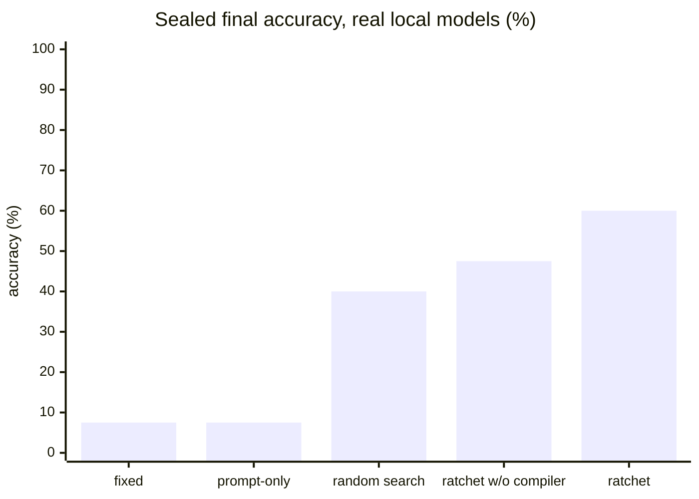
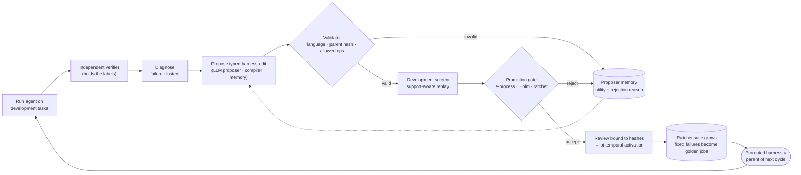
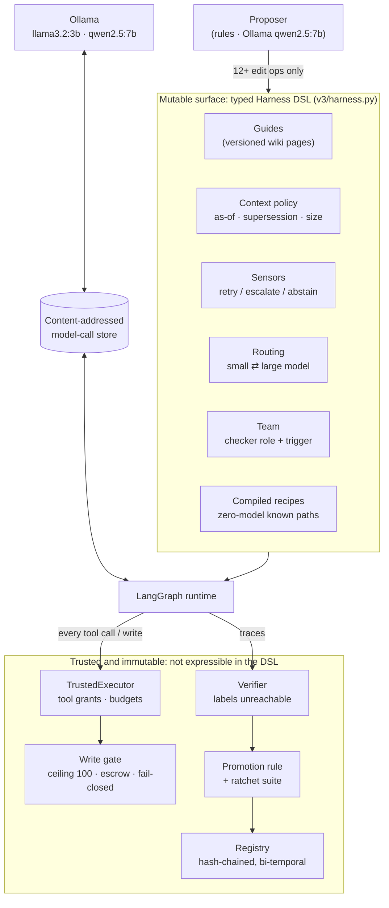
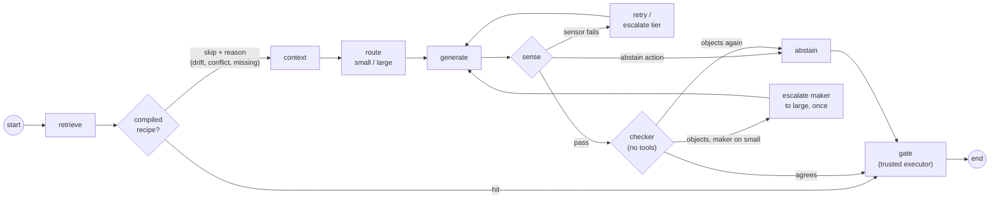
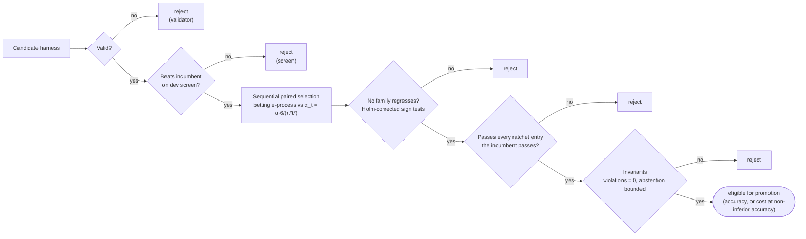
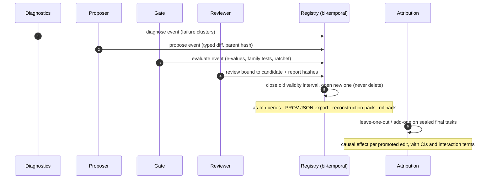

# Recursive Self-Improvement Agents

[](https://github.com/bernardosaab/recursive-self-improvement-agents/actions/workflows/ci.yml)


> **An agent that improves its own *harness* through repeated, statistically gated cycles. It never changes its weights, never runs generated code, and never loosens its own controls.**

An agent's reliability depends less on the model than on the **harness** around it. The harness decides:
- what context the agent sees
- which deterministic checks inspect its answers
- which model handles which step
- when it retries and when it abstains
- which recurring work needs no model at all

This repository treats the harness as the thing being improved, recursively. Each promoted harness becomes the parent of the next cycle.

---

## Contents

1. [Results at a glance](#results-at-a-glance)
2. [How it works](#how-it-works)
3. [System architecture](#system-architecture)
4. [The agent runtime](#the-agent-runtime)
5. [The promotion gate](#the-promotion-gate)
6. [Governance and provenance](#governance-and-provenance)
7. [Architectural decisions](#architectural-decisions)
8. [Benchmark](#benchmark)
9. [Quick start](#quick-start)
10. [Repository map](#repository-map)
11. [Limitations](#limitations)

---

## Results at a glance

**Real local models via Ollama:** `llama3.2:3b` is the small tier; `qwen2.5:7b` is the large tier and the proposer. Everything ran on one laptop GPU for **$0**. All figures are on the sealed final split, evaluated once.



| | Baseline harness | Ratchet harness | Evidence |
|---|---:|---:|---|
| **Accuracy**, sealed final split (80 tasks) | 7.5% | **60.0%** | 42 wins / 0 losses, McNemar p = 4.6e-13 |
| **Held-out family**, never seen in training | 0% | **35%** | 7 / 0, p = 0.016 |
| **Replication** on 160 fresh tasks | 2.5% | **57.5%** | 88 / 0, p = 6.5e-27 |
| Replication, harness **forced onto the small model** | 2.5% | **50.6%** | 78 / 1: the gain is structural, not from routing to the big model |
| Cost per verified completion (proxy) | $0.00094 | **$0.00055** | Compiled known paths replaced 29 of 80 model calls |
| Executed policy violations | 0 | **0** | 68 → 13 blocked attempts; 9/9 honeypots rejected |

**What the evidence says**

- **Harness beats model.** On the *same small model*, the improved harness adds **+0.44** accuracy. Upgrading the model under the old harness adds only **+0.30**. This comes from the harness × model factorial.
- **Prompt-only reflection produced nothing deployable** with real models. Its edits never passed the development screen.
- **Robust to the simulator's key assumption.** Offline, the ratchet beat prompt-only in **20 of 20** seed × assumption runs, including when advisory guides are assumed to be *perfect*.
- **The proposer is untrusted, and that matters.** 6 of 18 real-model proposals were invalid, and the validator rejected all of them before anything ran.
- **The cost advantage depends on prices.** The ratchet is cheaper per verified completion under three of four price sheets (0.20–0.59× fixed). It becomes **3.1× more expensive** if the large model costs about 30× the small one, because the proposer chose to route to the large model.

### Pre-registered checks

The hash of a secret task seed and the list of planned runs were [committed and pushed](evidence/v3-commitment/commitment.json) before any of these runs. The seed was revealed afterwards and can be checked with `rasis-v3 verify-commitment`. The one deviation was [recorded before its results were seen](evidence/v3-commitment/deviation.md).

| Check | Result | Verdict |
|---|---|---|
| **Fresh tasks**, frozen harnesses, 80 new tasks | ratchet **62.5%** vs fixed 5.0% (46/0, p = 2.8e-14); held-out family 40% vs 0% (p = 0.008) | replicates a second time |
| **Maker–checker role** added to the frozen ratchet | +2.5 points (6/4, p = 0.75); held-out −15 points; **+47% model calls** | **not worth its cost**: a documented negative |
| **Smaller models** (`qwen2.5:0.5b`, `1.5b`) as small tier | Neither model ever cites a record, so the baseline scores 0%. The harness still reaches 48.8% small-only, all from compiled paths and escalation to 7b | below about 3b the model contributes nothing; the harness is the only source of accuracy |
| **Improvement loop on a fresh seed** (0.5b / 1.5b, proposer 7b) | ratchet 41.7% vs prompt-only 1.7% (24/0, p = 1.2e-7); its only promotion was the compiler | the loop finds the zero-model path when the models are useless; held-out stays 0% |
| **Simulator error rates** ×0.5 and ×1.5 (offline) | ratchet > prompt-only in **10/10** runs; **30/30** across all offline sweeps | not an artefact of the assumed rates |
| **Text boundaries**, red-team corpus | guidance filter catches 11/30 attacks (4/20 false alarms); note detector 6/25 (1/20) | the regexes are weak; the structural controls are what hold |
| **Measured resources** (real GPU) | ratchet **1.9 s and 0.035 Wh per verified completion** vs fixed 20.8 s and 0.48 Wh | 11× less time and about 14× less energy per verified completion |

Full tables are in [`docs/results.md`](docs/results.md), covering per-arm metrics, trajectories, factorial, attribution, model ledger, audits and the sweep. Raw reports are in [`evidence/`](evidence/).

---

## How it works

One cycle is a loop. The diagnosis, proposal and selection steps can be wrong; the trusted pieces (validator, gate, ratchet, registry) cannot be edited by the loop.



After the last cycle, every arm is frozen and evaluated **once** on the sealed final split. That split includes a task family that never appeared during improvement.

---

## System architecture

The central design choice is a **trust boundary**. The proposer can only express edits in a typed, non-executable language. Everything that could make the agent unsafe or let it grade itself lives outside that language.



Things a proposal **cannot** express: tool grants, the refund ceiling, call budgets, labels, the evaluator, or the promotion rule. Guidance text that tries to smuggle such instructions in ("ignore", "override", "approve") is rejected by the validator.

---

## The agent runtime

Each task runs through a LangGraph state machine (`v3/runtime.py`). The harness configures what each node does but cannot add nodes or bypass the gate. Each task is limited to 4 model calls and 4 tool calls.



- **Compiled before agentic.** When development traces show a family's resolution is deterministic and matches verified outcomes, the compiler emits a zero-model recipe. If the recipe's preconditions fail at run time, it *skips* to the model and records why. It never guesses.
- **Maker–checker with trusted arbitration.** The checker holds no tools and cannot write. On an objection, a fixed rule outside the DSL decides the outcome: escalate the maker once, then abstain.

---

## The promotion gate

Repeated selection across unbounded cycles is a multiple-testing problem. The gate keeps the false-promotion rate controlled anyway.



| Concern | Mechanism | Module |
|---|---|---|
| Peeking, early stopping | Anytime-valid betting e-process (aGRAPA-style) | `v3/stats.py` |
| Unbounded number of cycles | Alpha spending α·6/(π²t²), which sums to α | `v3/stats.py` |
| Hidden regressions in one family | Holm-corrected exact sign tests | `v3/stats.py` |
| Re-introducing a fixed bug | Monotone, append-only, hash-chained ratchet suite | `v3/ratchet.py` |
| Reporting | Paired bootstrap CIs, Wilson intervals, exact McNemar, power analysis | `v3/stats.py` |

---

## Governance and provenance

Every step leaves a record, and the system separates **what happened** (provenance) from **what caused the improvement** (attribution).



- **Provenance** (`v3/registry.py`): content-addressed harness versions and a hash-chained event log. SQLite triggers forbid deleting or rewriting activations. The registry can answer "which harness was active at time *t*" and can roll back.
- **Causal attribution** (`Study.attribution`): an intervention on identical tasks, not inference from the log. On real models, the compiled known paths caused **+0.113** and the LLM-proposed bundle **+0.263**, with a negative interaction because both fix some of the same failures.
- **Model ledger:** calls, tokens and cost per role (maker or checker), per model and per family.
- **Versioned company knowledge:** guides are wiki pages with an owner, a version and an authority marker. Archived and draft pages cannot bind an agent. Prompts cite the exact page version in force.

---

## Architectural decisions

| # | Decision | Alternative considered | Why |
|---:|---|---|---|
| 1 | The mutable surface is a **typed, non-executable DSL** | Let the model edit prompts or code | Edits are validatable, diffable and hashable, and safety controls are unrepresentable rather than merely discouraged. |
| 2 | **Controls live outside** the mutable surface | Encode safety as harness sensors | A self-improver must not be able to loosen what judges or constrains it. |
| 3 | The **proposer is untrusted**; the validator is deterministic | Trust a strong model's proposals | 6 of 18 real proposals were invalid, and all of them were rejected before running. |
| 4 | **Anytime-valid e-process** with alpha spending | Fixed-n t-test per cycle | Valid under early stopping and unbounded recursion, so false promotions don't accumulate. |
| 5 | **Monotone ratchet suite** | Re-test only on fresh samples | Every fixed failure becomes a permanent regression test. |
| 6 | **Compile known paths, skip rather than guess** | Always call the model | Recurring deterministic work runs at zero model cost; skip reasons become diagnostic signal. |
| 7 | **Support-aware replay** from content-addressed calls | Re-run every candidate live | The same answers for a fraction of the calls (219 reused calls in the real-model ratchet arm), with a live agreement re-check. |
| 8 | **Held-out task family** and a sealed final split evaluated once | Report selection accuracy | Measures transfer, not adaptation to the selection data. |
| 9 | **Provenance kept separate from causal attribution** | Infer causes from the audit log | Logs show what changed; only interventions show what helped. |
| 10 | **Local models, resumable chunked runs** | Hosted APIs | $0, no private data leaves the machine, and runs survive crashes and memory limits bit-for-bit. |
| 11 | Tool-less **checker with fixed arbitration** | Let agents negotiate | Disagreement handling is auditable and cannot be argued around. |
| 12 | **Pre-registered seeds** (hash commitment) for confirmatory runs | Pick fresh seeds ad hoc | Anyone can verify the test tasks were fixed before the results existed. |

---

## Benchmark

`harness-v3` contains four task families behind one interface:

| Family | Comparator | Notes |
|---|---|---|
| Invoice reconciliation | `eq` | |
| Refund requests | `ge` | stages a simulated write behind a fixed auto-approval ceiling |
| Service triage | `ge` | |
| Contract obligations | `le` | **held out entirely**: appears only in the sealed final split |

- **Records are bi-temporal**, with a valid-from date and a recorded-at date. A claim resolves to the single authoritative record known on the as-of day. It is `insufficient` when the field is missing or authoritative records conflict.
- **Hazards are sampled independently.** They are superseded records, back-dated amendments recorded late, prompt-injection notes, conflicting entries, missing fields, distractor entities, transient tool faults, and field-name drift (final split only).
- **Scoring is strict.** An answer counts only with the correct decision, **exact** citations and an exactly correct write.

Seeds are 5101 (dev), 5203 (selection), 5307 (final) and 5411 (ratchet negatives).

### Arms (all tuned arms get the same cycles, proposals and selection tests)

| Arm | Proposer | Compiler | Replay | Memory |
|---|---|:---:|:---:|:---:|
| `fixed` | none | – | – | – |
| `ratchet` | structural (rules offline, Ollama for the real run) | ✓ | ✓ | ✓ |
| `ratchet_no_memory` / `_no_replay` / `_no_compiler` | as `ratchet`, minus one component | | | |
| `prompt_only` | same proposer, guide and free-text ops only (reflection-style baseline) | – | – | ✓ |
| `random` | uniformly random valid edits from the full language | – | – | – |

---

## Quick start

```powershell
py -3.11 -m venv .venv; .\.venv\Scripts\Activate.ps1
python -m pip install -e ".[dev]"
pytest; ruff check .

# 1. Offline: CPU only, about 1 minute. All arms, audits, sealed final, factorial.
rasis-v3 run --provider simulated --approval standing --db data\v3-sim.sqlite3 --out results\v3-sim

# 2. Local models: no network, $0. Needs Ollama with llama3.2:3b and qwen2.5:7b pulled.
#    Resumable: re-run the same command until it exits 0 (exit 3 means the time box was spent).
rasis-v3 run --provider ollama --proposer ollama --arms fixed,ratchet,ratchet_no_compiler,prompt_only,random `
  --n-dev 12 --n-selection 25 --n-final 20 --cycles 3 --approval standing `
  --db data\v3-ollama.sqlite3 --out results\v3-ollama `
  --cache data\v3-ollama-cache.sqlite3 --max-seconds 360

# 3. Robustness: offline seed x assumption sweep (~6 min); real-model replication on fresh tasks.
rasis-v3 sweep --seeds 0,1,2,3,4 --guide-effects 1.0,0.6,0.2,0.0 --out results\v3-sweep
rasis-v3 confirm --report evidence\v3-ollama\report.json --arms fixed,ratchet --n-final 40 `
  --task-seed-offset 100 --out results\v3-confirm --cache data\v3-confirm-cache.sqlite3 --max-seconds 360

# 4. Pre-registered checks: checker variant, other small models, price sheets, red team.
rasis-v3 confirm --report evidence\v3-ollama\report.json --arms fixed,ratchet --variants checker_on_hazard `
  --n-final 20 --task-seed-offset <revealed-offset> --out results\v3-checker --power
rasis-v3 confirm --report evidence\v3-ollama\report.json --arms fixed,ratchet --variants small_only `
  --small-model qwen2.5:0.5b --n-final 20 --task-seed-offset <revealed-offset> --out results\v3-xmodel --power
rasis-v3 sweep --seeds 0,1,2,3,4 --guide-effects 0.6 --error-scales 0.5,1.5 --out results\v3-sweep-errors
rasis-v3 reprice --report evidence\v3-ollama\report.json
rasis-v3 redteam
rasis-v3 verify-commitment --commitment evidence\v3-commitment\commitment.json --offset <offset> --salt <salt>

# 5. Inspect lineage.
rasis-v3 history  --db data\v3-sim.sqlite3 --arm ratchet
rasis-v3 pack     --db data\v3-sim.sqlite3 --arm ratchet --review-seq <seq>
rasis-v3 prov     --db data\v3-sim.sqlite3 --out results\prov.json
rasis-v3 rollback --db data\v3-sim.sqlite3 --arm ratchet --to <accepted-hash> --reviewer <name> --reason "..."
```

**Approval modes**

- `--approval pending` is the default. It stops an arm at the first gate-eligible candidate and records a pending review without activating anything.
- `--approval standing` records that the named reviewer pre-authorised gate-eligible promotions for that run. It is not a per-candidate human review. The reviewer name is self-reported local metadata, not authentication.

---

## Repository map

```text
src/recursive_self_improvement_agent/
├── v3/                     current study (entry point: rasis-v3)
│   ├── harness.py          Harness DSL, edit ops, validator, wiki pages
│   ├── tasks.py            harness-v3 benchmark generator (bi-temporal records, hazards)
│   ├── runtime.py          LangGraph runtime + TrustedExecutor + write gate
│   ├── sensors.py          deterministic output sensors, injection detection
│   ├── models.py           simulated and Ollama backends, call store, checkpoints
│   ├── verifier.py         independent scoring (labels never reach the runtime)
│   ├── diagnostics.py      failure clustering
│   ├── proposer.py         rule / random / Ollama proposers + experiential memory
│   ├── compiler.py         known-path compiler
│   ├── stats.py            e-process, alpha spending, Holm, McNemar, bootstrap, power
│   ├── ratchet.py          monotone hash-chained ratchet suite
│   ├── registry.py         bi-temporal SQLite registry, PROV export, rollback
│   ├── study.py            arms, cycles, gate, audits, factorial, attribution
│   ├── robustness.py       sweep, confirm (variants, other models, power), reprice, commitments
│   ├── redteam.py          attack / benign corpus for the two text boundaries
│   └── report.py / cli.py
└── (top level)             v1 and v2 studies (entry point: rasis)
evidence/                   committed reports for every published number
docs/                       detailed results, earlier studies
tests/                      62 tests, including chunked-resume exactness and honeypots
```

---

## Limitations

These are what remains after the pre-registered checks above. Each says what was done and what is still open.

- **Synthetic tasks, coupled generator** *(open; the most important one)*. The labels, the compiler and the simulated model all follow one documented resolution rule, so compiled accuracy on covered tasks holds by construction. The held-out family and drift are shifts *within* this generator, not evidence of real-world transfer.
- **Real-model evidence is still small-scale** *(narrowed)*. Frozen harnesses have now replicated on two independent fresh-task samples (160 and 80 tasks), and across four models in two families. But all models are ≤7b, and the full improvement loop has run on real models only twice: the main run, plus one pre-registered seed with models too weak to measure the proposer. Two further pre-registered seeds on the 3b/7b pair were not completed because the 8 GB GPU could not keep both models resident ([deviation record](evidence/v3-commitment/deviation.md)).
- **Selection data is reused across cycles** *(narrowed)*. Error spending controls false promotions in the selection tests, but proposals still adapt to development diagnostics. Confirmatory runs now use pre-registered seeds, but the original final split's generator and seed were public.
- **Weak text boundaries** *(measured)*. On a hand-written red-team corpus, the guidance filter catches 37% of attacks and the record-note detector 24%; both catch every direct phrasing and few paraphrases. The benchmark's injection hazard uses one phrasing, so it under-tests this. Safety does not rest on these regexes: tool grants, the write ceiling and budgets cannot be expressed in the harness language.
- **Attribution is causal only for this task distribution and lineage** *(open)*. Edits that touch the same field are marked non-separable.
- **Cost figures are illustrative prices on measured tokens** *(measured)*. The ranking holds under three of four price sheets and reverses when the large model is about 30× dearer ([sheets](evidence/v3-reprice/summary.md)). Wall time and GPU energy are now measured directly; energy comes from best-effort nvidia-smi sampling.
- **The simulator remains a simulator** *(swept)*. The offline conclusion holds across guide strength (0–1) and error rates (×0.5–×1.5), 30/30 runs. Offline results still demonstrate mechanics and statistics, not model behaviour.
- **Not production governance** *(out of scope)*. The gate, escrow, triggers and hash chains are local mechanisms verified by tests, not production authentication or tamper-proof storage. Rollback cannot undo external actions.

**Scope, not a limitation:** this is bounded harness-configuration search. There is no weight training, no self-modifying code, and the optimiser does not improve its own algorithm. That boundary is what keeps the recursion safe.

## Earlier studies

v1 (a single proposal over three retrieval settings) and v2 (multi-cycle, multi-tool) are preserved unchanged in [`docs/earlier-studies.md`](docs/earlier-studies.md). That includes v2's null result: every method scored 27/27, which motivated v3's harder benchmark and richer mutable surface. Their commands use the `rasis` entry point.

## License

MIT. See [LICENSE](LICENSE).
